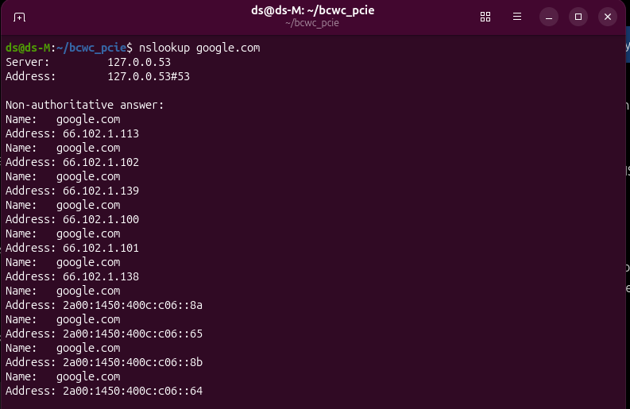
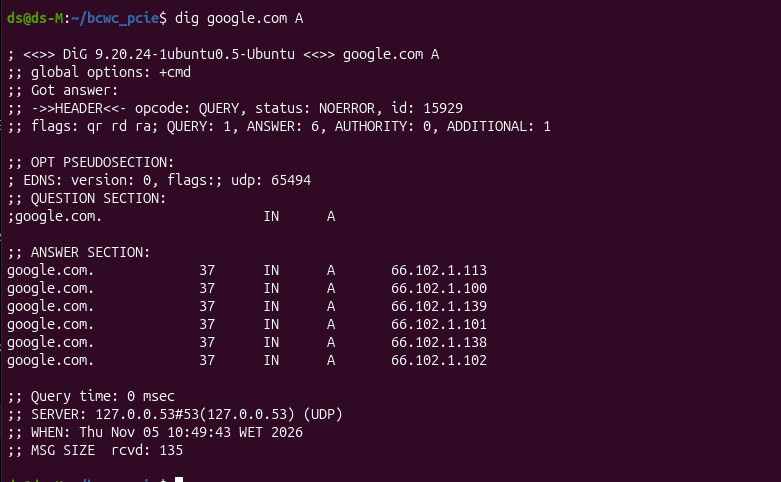

# DNS Troubleshooting Lab

## Scenario

A user reports that they cannot access a website by its domain name, while other websites appear to work.

## Objective

Verify DNS resolution and basic network connectivity using command-line tools on Ubuntu.

## Environment

- Operating system: Ubuntu
- Network interface: `wlp3s0`
- Local DNS resolver: `127.0.0.53`
- Configured DNS server: `192.168.1.1`

## Tests Performed

### 1. DNS lookup with nslookup

Command:

```bash
nslookup google.com
```

Result:

- The domain resolved successfully.
- IPv4 and IPv6 addresses were returned.
- The local DNS resolver was `127.0.0.53`.

### 2. DNS lookup with dig

IPv4 query:

```bash
dig google.com A
```

Result:

- Status: `NOERROR`
- One IPv4 answer was returned.
- Query time: 7 ms.

IPv6 query:

```bash
dig google.com AAAA
```

Result:

- Status: `NOERROR`
- One IPv6 answer was returned.
- Query time: 6 ms.

### 3. Identify the configured DNS server

Command:

```bash
resolvectl status
```

Result:

- Network interface: `wlp3s0`
- Configured DNS server: `192.168.1.1`
- Resolver mode: `stub`

### 4. Test connectivity to an IP address

Command:

```bash
ping -c 4 8.8.8.8
```

Result:

- 4 packets transmitted
- 4 packets received
- 0% packet loss
- Average latency: approximately 14 ms

### 5. Test connectivity using a domain name

Command:

```bash
ping -c 4 google.com
```

Result:

- The domain resolved to an IPv4 address.
- 4 packets transmitted
- 4 packets received
- 0% packet loss
- Average latency: approximately 13 ms

## Initial Conclusion

DNS resolution for `google.com` and basic IP connectivity were working during testing.

These results establish a working baseline. The reported issue has not yet been reproduced, so further tests would be required to identify the cause of a domain-specific failure.

## Tools Used

- `nslookup`
- `dig`
- `resolvectl`
- `ping`
## Screenshots

### Successful DNS lookup with nslookup

The `nslookup` command successfully resolved `google.com` and returned IPv4 and IPv6 addresses.



### DNS A record lookup with dig

The `dig` command returned `NOERROR` and six IPv4 A records for `google.com`.



